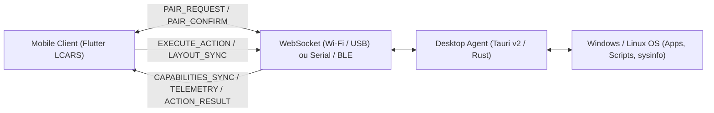

# LCARS Launcher

Monorepo do **LCARS Launcher**, um sistema de painel de controle remoto e telemetria inspirado na interface **LCARS** (*Library Computer Access/Retrieval System*) de Star Trek.

Transforme qualquer tablet ou smartphone em um console tátil dedicado para disparar ações no PC (apps, macros, mídia, scripts) e monitorar telemetria de hardware em tempo real.

---

## Arquitetura do Monorepo

```text
lcars_launcher/
├── protocol/           # Especificação formal v1.0, JSON Schemas e payloads de exemplo
│   ├── PROTOCOL.md
│   ├── schemas/        # JSON Schemas (Draft 2020-12) das mensagens
│   └── examples/       # Exemplos reais de payloads JSON
├── desktop-agent/      # Servidor/daemon portátil (Windows & Linux) em Tauri v2 + Rust
│   ├── src/            # UI minimalista de configuração (HTML + Tailwind CSS + TypeScript)
│   └── src-tauri/      # Backend Rust (WebSocket server, sysinfo telemetry, executor de ações)
└── mobile-client/      # Aplicativo Flutter (Dart) com interface LCARS para tablet/smartphone
    ├── lib/theme/      # Paleta e tipografia LCARS
    ├── lib/protocol/   # Modelos Dart espelhando /protocol
    ├── lib/services/   # Camada de transporte (WebSocket Wi-Fi/USB, extensível para BLE/Serial)
    ├── lib/widgets/    # Componentes LCARS (LcarsElbow, LcarsButton)
    └── lib/screens/    # Console principal LCARS
```

### Fluxo de Comunicação



### Protocolo Bidirecional (`/protocol`)

Todas as mensagens seguem o envelope definido em [`protocol/PROTOCOL.md`](./protocol/PROTOCOL.md):

| Mensagem | Direção | Descrição |
| :--- | :--- | :--- |
| `PAIR_REQUEST` / `PAIR_CONFIRM` | Mobile ↔ Desktop | Pareamento via PIN de 6 dígitos ou QR Code emitindo token persistente |
| `CAPABILITIES_SYNC` | Desktop → Mobile | Sincroniza ações executáveis registradas e sensores disponíveis |
| `TELEMETRY` | Desktop → Mobile | Pacote periódico (500–1000 ms) com CPU (%), RAM livre/total, temperatura e rede |
| `EXECUTE_ACTION` / `ACTION_RESULT` | Mobile ↔ Desktop | Disparo seguro por `action_id` correlacionado via `req_id` |
| `LAYOUT_SYNC` | Mobile ↔ Desktop | Backup/restauração da grade visual (blocos de ação e blocos read-only) |

---

## Como Rodar em Ambiente de Desenvolvimento

### 1. Desktop Agent (`/desktop-agent`)

**Pré-requisitos:**
- [Rust / Cargo](https://rustup.rs/) (stable)
- [Node.js](https://nodejs.org/) v20+ e `npm`
- Dependências de sistema do [Tauri v2](https://v2.tauri.app/start/prerequisites/) (no Linux: `libwebkit2gtk-4.1-dev`, `libgtk-3-dev`, `libayatana-appindicator3-dev`, `librsvg2-dev`; no Windows: WebView2 + Visual Studio C++ Build Tools).

```bash
cd desktop-agent
npm install
npm run tauri dev
```

O agente abrirá a janela minimalista de configuração com o **PIN de 6 dígitos** e iniciará automaticamente o servidor WebSocket em `ws://0.0.0.0:8765/ws`.

> Para rodar apenas o preview da interface web sem o backend Rust: `npm run dev` (porta `1420`).

---

### 2. Mobile Client (`/mobile-client`)

**Pré-requisitos:**
- [Flutter SDK](https://docs.flutter.dev/get-started/install) 3.22+ (Dart 3.4+)
- Emulador Android/iOS ou dispositivo físico conectado via USB/Wi-Fi.

```bash
cd mobile-client

# (Apenas na primeira execução, caso ainda não existam os diretórios android/ e ios/)
flutter create . --platforms=android,ios

flutter pub get
flutter test
flutter run
```

#### Modo USB sem Wi-Fi (Android via ADB)
Para conectar o tablet/smartphone diretamente via cabo USB usando o mesmo transporte WebSocket:

```bash
adb reverse tcp:8765 tcp:8765
```

Em seguida, conecte o Mobile Client em `ws://127.0.0.1:8765/ws` e informe o PIN exibido no Desktop Agent.

---

## Scripts de Build

O monorepo disponibiliza scripts individuais e de build completo em sequência (**Mobile → Desktop**) em `scripts/` e no `Makefile`.

### Linux / macOS (Bash ou Make)
```bash
# Build completo em sequência (Mobile APK + Desktop Agent release)
./scripts/build-all.sh
# ou com alvo mobile customizado (apk | appbundle | ios | web):
./scripts/build-all.sh appbundle
# ou via Makefile:
make build-all

# Apenas Mobile Client (gera android/ se ausente, roda analyze/test e build release)
./scripts/build-mobile.sh apk

# Apenas Desktop Agent (build frontend Vite + bundle Tauri v2 release)
./scripts/build-desktop.sh
# Verificação rápida sem empacotar instalador:
./scripts/build-desktop.sh --check-only
```

### Instalação no Linux (Usuário ou Sistema)
O script `scripts/install-desktop.sh` copia o binário release (compilando-o automaticamente se necessário), instala os ícones no tema `hicolor`, cria o atalho `.desktop` no menu de aplicativos e oferece suporte opcional a inicialização automática (`autostart`):

```bash
# Modo interativo (permite escolher entre instalação de usuário ou de sistema)
./scripts/install-desktop.sh
# ou via Makefile:
make install-desktop

# Instalação ao nível do usuário (~/.local, sem sudo)
./scripts/install-desktop.sh --user
./scripts/install-desktop.sh --user --autostart

# Instalação ao nível do sistema (/usr/local, solicita sudo apenas na cópia)
./scripts/install-desktop.sh --system
./scripts/install-desktop.sh --system --autostart

# Desinstalação
./scripts/install-desktop.sh --uninstall --user
./scripts/install-desktop.sh --uninstall --system
```

### Windows (PowerShell)
```powershell
# Build completo em sequência (Mobile -> Desktop)
.\scripts\build-all.ps1 -MobileTarget apk

# Apenas Mobile Client
.\scripts\build-mobile.ps1 -Target apk

# Apenas Desktop Agent
.\scripts\build-desktop.ps1
# Verificação rápida:
.\scripts\build-desktop.ps1 -CheckOnly
```

